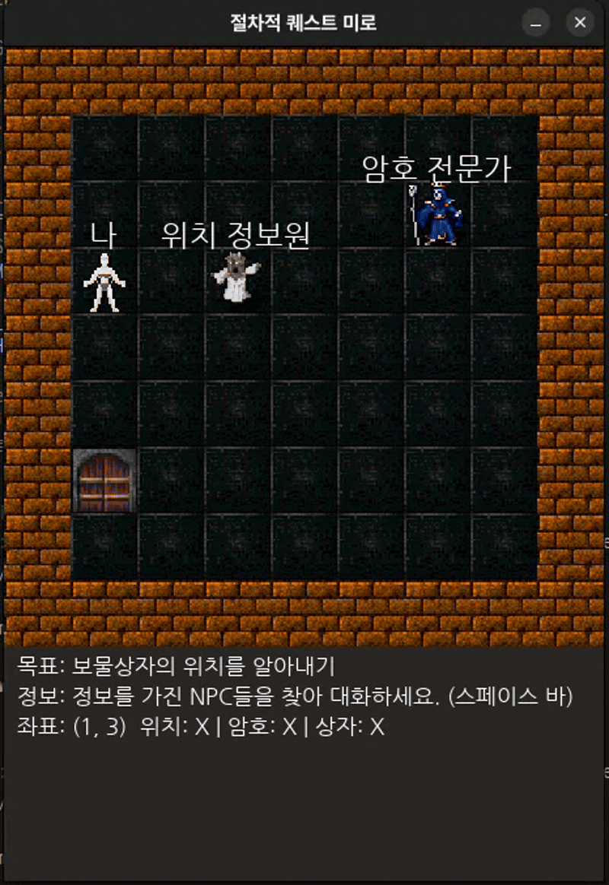
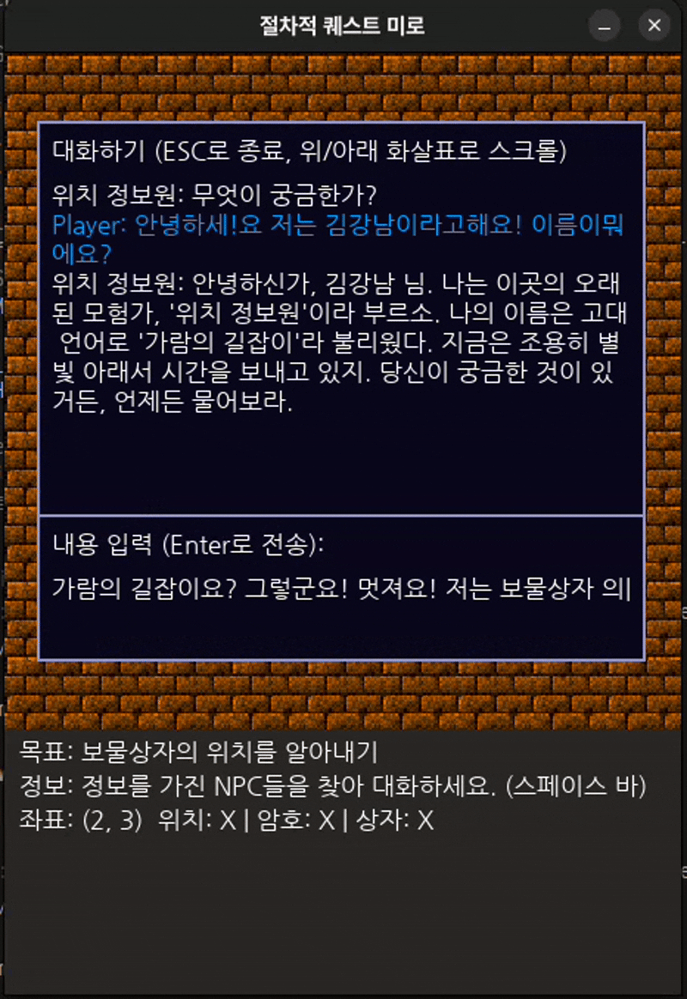
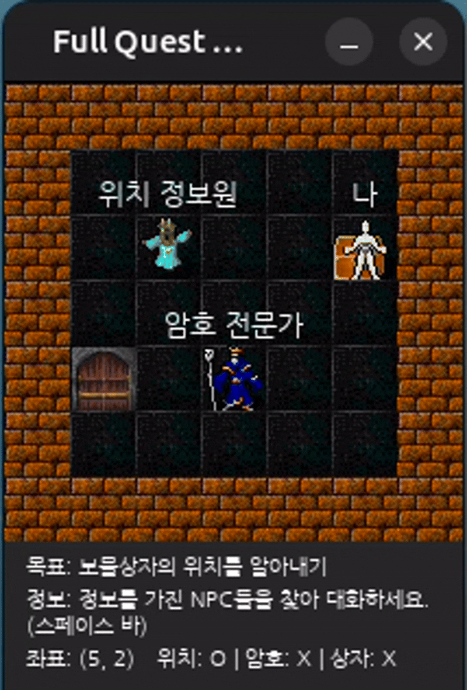
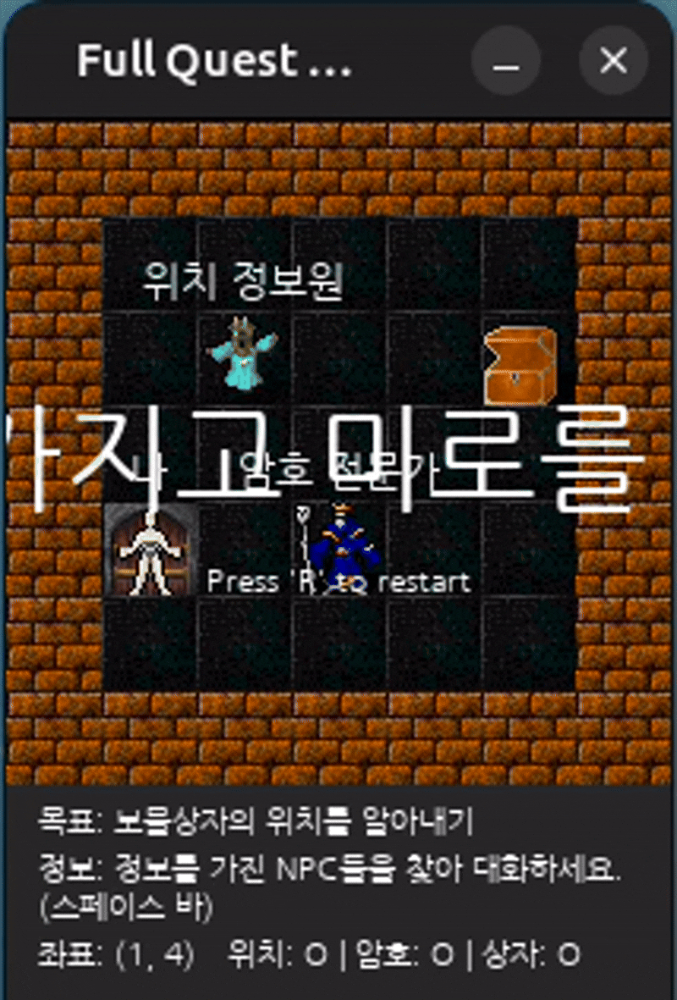

# Procedural Quest Maze (Portfolio Project)

In this Pygame maze, the player asks two NPCs for a treasure's location and password, opens the chest, and reaches the exit. The interactive game uses a local Ollama chat client. A separate Gymnasium environment lets a committed PPO policy (`rl/ppo_full_quest.zip`) attempt the same quest with rule-based NPC interactions, not generated dialogue.

In one reproducible headless run (seeds 0–19, 1024-step limit), the checkpoint completed 14 quests and timed out on 6. This is a small sample, not a general success-rate estimate. [Repeat the run](#evaluate-the-pre-trained-agent).

## Core Features

- **Procedural Maze Generation**: A new, fully connected maze is generated at the start of each game using a randomized algorithm, ensuring unique gameplay every time.

- **LLM-Powered NPCs**: NPCs are driven by an LLM, allowing for dynamic and unscripted conversations. Their personalities and core information are defined in external Markdown files, enabling easy modification and experimentation without changing game code.

  
  

- **Dynamic Quest System**: Players must interact with NPCs to gather crucial information (e.g., the location of a treasure and its password) to complete the objective. The system tracks player knowledge to dynamically update objectives.

- **Modular & Scalable Architecture**: The codebase is intentionally structured to be modular and maintainable, demonstrating a clear **Separation of Concerns (SoC)**:
    - `controllers`: Handle all player input (`InputHandler`) and high-level interaction logic (`InteractionHandler`).
    - `renderers`: Responsible for all on-screen drawing, completely decoupled from the game logic.
    - `games`: Contains the core game state (`Game`) and state definitions (`GameState`).
    - `ui`: Manages UI overlays like menus and text boxes.
    - `configs`: Centralizes all game settings for easy tuning.
    - `clients`: Wraps external services like the LLM, providing a consistent interface to the rest of the application.

## Installation

1.  **Clone the repository:**
    ```bash
    git clone https://github.com/kangnam7654/Game-NPC-with-LLM.git
    cd Game-NPC-with-LLM
    ```

2.  **Install dependencies:**
    It is recommended to use a virtual environment. This project uses dependencies listed in `pyproject.toml`.
    ```bash
    pip install -e .
    ```
    *Note: Heavy libraries like `torch` may require a specific version tailored to your system's hardware (e.g., CUDA support). Please install them according to your environment if needed.*

## How to Run

**Prerequisite for NPC chat:** a local [Ollama](https://ollama.com) server on `localhost:11434` with the model hard-coded in `main.py`, `gpt-oss:20b` (for example `ollama pull gpt-oss:20b`). Nothing else is configured: no remote provider, no API key. Without the server, the game still runs. Free chat shows a failure notice, and the fixed-information menu still works.

Execute the main script from the project root directory (sprites and fonts are loaded from relative paths):

```bash
python main.py
```

## Controls

-   **Movement**: Arrow Keys (↑, ↓, ←, →) or W/A/S/D
-   **Interact**: Spacebar (when adjacent to an NPC or object)
-   **Menu Navigation**: Arrow Keys (↑, ↓)
-   **Confirm / Send chat message**: Enter
-   **Scroll chat**: Arrow Keys (↑, ↓) while chatting
-   **Cancel / Exit Menu or Chat**: ESC (leaving a chat clears that NPC's chat history)

## NPC Dialogue: Behaviour and Limits

Each NPC menu has two ways to get information:

1. **Fixed information** (`(고정된) 정보 확인`) is deterministic and never calls the LLM. The location NPC gives the coordinates. The password NPC gives the password only after the location is known.
2. **Free chat** (`자유롭게 대화하기`) sends the NPC's recent history, at most 6 messages, to Ollama (`llm/clients/ollama_client.py`).

How free chat behaves:

- **One request with timeouts.** Each reply comes from one non-streaming `POST /api/chat` with a timeout of 5 s to connect and 120 s of read inactivity. This is not a total wall-clock deadline. The call runs on the game thread, so the window stops responding while it waits. Streaming (`stream=True`) is rejected because the client does not parse NDJSON.
- **Failures are explicit.** Failure cases are: no connection, a timeout, a non-2xx status, a body that is not JSON, or a body without a non-empty text `message.content`. In all of them the client returns `None`. The game shows a retryable notice in the info panel. It adds no reply to the history, changes no quest flag and keeps your typed text, so Enter retries and ESC leaves. Error messages do not include the prompt or the response body.
- **Quest progress comes from a text heuristic.** It does not understand meaning (`game/controllers/interaction_handler.py`).
  - **Location:** the location NPC's reply must mention the treasure/location and give an explicit coordinate pair such as `(x, y)`, `좌표는 x, y` or `x=…, y=…`. Every pair in the reply must be the correct one. A lone digit, a wrong `y` or unrelated numbers do not count.
  - **Password:** only counts after the location is known. The password NPC's reply must state it explicitly, for example `암호는 '7'`.
  - **What is ignored:** statements in negated sentences or questions, values the player typed in the same message, and information from the other NPC.
  - **Misjudgements are possible.** Spelled-out numbers or unusual phrasing can be missed, and a misleading reply can be misread. The fixed menu is the reliable path.
- **The password stays out of the prompt until it is earned.** Until the location is known, the password NPC's system prompt has a placeholder instead of the password. This only limits what the model is given. It is not a security boundary.

No model-backed evaluation of these conversations is reported here. The automated tests use scripted, synthetic replies.

## Offline Tests

With `pytest` installed, the tests are meant to run without Ollama, a GPU, external network access or a display. They use the SDL dummy video driver.

```bash
python -m pytest tests/
```

`tests/test_npc_dialogue.py` checks the following:

- The Ollama client against a mocked `requests.post` and a loopback HTTP server: success, missing or malformed bodies, HTTP errors and timeouts.
- Headless Pygame interaction with a scripted fake LLM: coordinate and password rules, failed and retried chat, history bound and the fixed menu.

The RL tests (`tests/test_rl_*.py`) are separate.

## Reinforcement Learning Environment

This project also includes a reinforcement learning environment based on the game logic (`rl/environments/full_quest_env_pass.py`). A PPO agent was trained to attempt the full quest: location NPC → treasure → password NPC → enter the one-digit password at the treasure → exit.




In this environment the NPCs are **rule-based**: being adjacent and choosing "interact" sets the corresponding knowledge flag. No LLM is called, so RL results say nothing about the LLM conversations shown above.

### Evaluate the pre-trained agent

`rl/run_full_quest.py` loads the committed checkpoint (path resolved from the repository root, so it works from any directory), runs the policy deterministically, and prints a JSON report. It never trains, downloads, or calls an LLM.

```bash
# Quick headless evaluation (no window, no delay)
python rl/run_full_quest.py --episodes 20 --seed 0

# Optional: watch it in a Pygame window (needs a desktop)
python rl/run_full_quest.py --episodes 3 --render --delay 0.2
```

- **Seed**: episode *i* is reset with `seed + i`, which reproduces the same map, positions, and password.
- **Horizon**: `--max-steps` (default `1024`, the training limit) is enforced with Gymnasium's `TimeLimit`.
- **Outcome**: each episode is `solved` (the environment *terminated*: treasure opened and exit reached) or `truncated` (time limit hit first). The report also lists the step at which each quest milestone was first reached. It is a small deterministic sample on the listed seeds, not a benchmark.

With the checked-in checkpoint, `--episodes 20 --seed 0 --max-steps 1024` completed 14 quests and truncated 6. For example, seed 2 found the treasure but never obtained the password before the step limit. These are observed outcomes for this checkpoint and these generated layouts only; they do not establish a general completion rate. The report retains per-seed steps and quest milestones, including unsuccessful runs. Only load checkpoints you trust.

### Train the agent (optional)

The evaluation result above comes from the committed checkpoint `rl/ppo_full_quest.zip`. Training was not rerun to produce it, and the training script never writes to that file.

`rl/train_full_quest.py` needs a **new** `--output-dir` and a bounded `--timesteps`. It refuses to use an existing directory. Every file from a run goes into that directory: the final `ppo_full_quest.zip`, `best_model/`, monitor CSVs, `evaluations.npz` and `run_config.json`. `rl/logs/` is git-ignored, so it is a convenient place for runs. Importing the script or running `--help` does nothing else.

```bash
# Long run with the original settings (PPO MultiInputPolicy, 1024-step episodes,
# lr 1e-4, n_steps 512, batch 64, n_epochs 20, eval every 10,240 steps over 5 episodes)
python rl/train_full_quest.py --output-dir rl/logs/run-001 --timesteps 20000000

# Short CPU smoke run: only checks that the pipeline works; it does NOT train a useful policy
python rl/train_full_quest.py --output-dir rl/logs/smoke-001 --timesteps 128 \
    --n-steps 64 --n-epochs 1 --eval-freq 64 --eval-episodes 1 --device cpu

# Optional: continue from a full SB3 PPO checkpoint that you trust
python rl/train_full_quest.py --output-dir rl/logs/resume-001 --timesteps 1000000 \
    --resume /path/to/trusted_checkpoint.zip

# Evaluate any resulting checkpoint the same way as the committed one
python rl/run_full_quest.py --model rl/logs/run-001/ppo_full_quest.zip --episodes 20 --seed 0
```

- **Scratch by default; resume only on request.** `--resume` loads a complete SB3 PPO checkpoint and keeps its hyperparameters. Its observation and action spaces must match `FullQuestEnv`. `--timesteps` then counts additional steps. A missing, unreadable or incompatible checkpoint stops the script with an error before any output is created. It never falls back to training from scratch.
- **Trusted files only.** SB3 checkpoints contain pickled Python objects, and loading one can run code. `--resume` is not a security sandbox.
- **Seeds.** `--seed` (default 0) seeds the model and the training environment. The evaluation environment uses `seed + 10000`. The script restores the process-global `random`, NumPy and torch generator states after the run. Results with the same seed may still differ across library versions or hardware.
- **Smoke vs. long training.** Smoke runs and the automated tests only show that the code runs. They do not show that a long run reproduces the committed checkpoint's behaviour, and they say nothing about policy quality. No new training results are reported here. The RL environment uses rule-based NPCs, so training says nothing about the LLM dialogue. `--tensorboard` (optional) writes TensorBoard logs into the output directory.

## Project Structure

```
/
├── configs/            # Game settings (screen size, colors, prompt paths, etc.)
├── game/
│   ├── actors/         # Game character logic (e.g., NPC class)
│   ├── controllers/    # Player input and interaction logic (incl. dialogue heuristic)
│   ├── fonts/          # Font files used in the game
│   ├── games/          # Core game logic and state management
│   ├── maps/           # Maze generation logic
│   ├── renderers/      # Screen rendering logic
│   ├── sprites/        # Image assets (player, walls, NPCs, etc.)
│   └── ui/             # UI element management (menus, text boxes)
├── llm/
│   ├── clients/        # LLM clients (Ollama chat client used by main.py)
│   └── prompts/        # Markdown files defining NPC personalities and knowledge
├── rl/                 # Rule-based RL environment, PPO checkpoint, train/eval scripts
├── tests/              # Offline tests (NPC dialogue, RL)
├── main.py             # Main entry point of the application
├── pyproject.toml      # Project metadata and dependencies
└── README.md           # This file
```