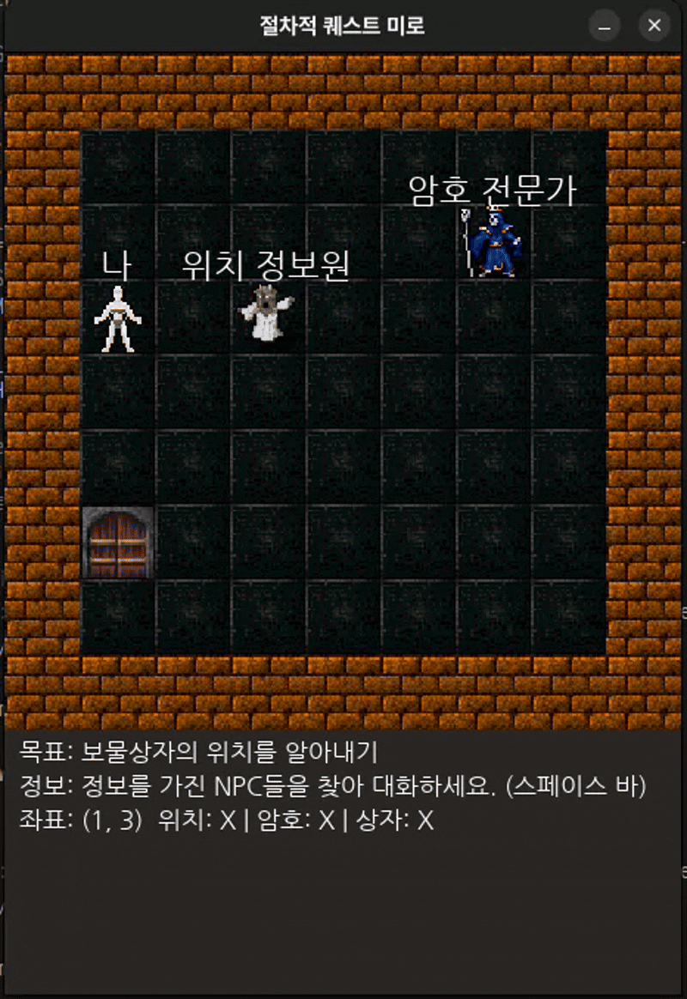
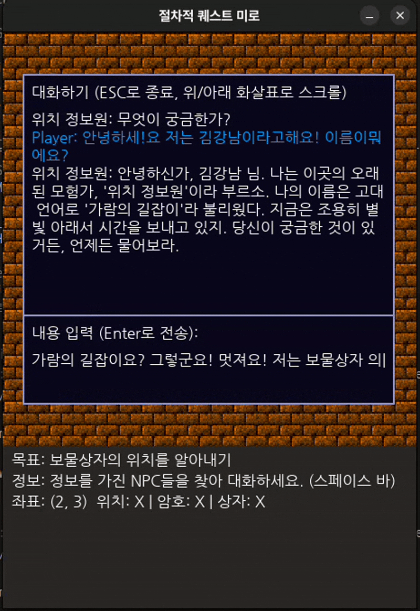
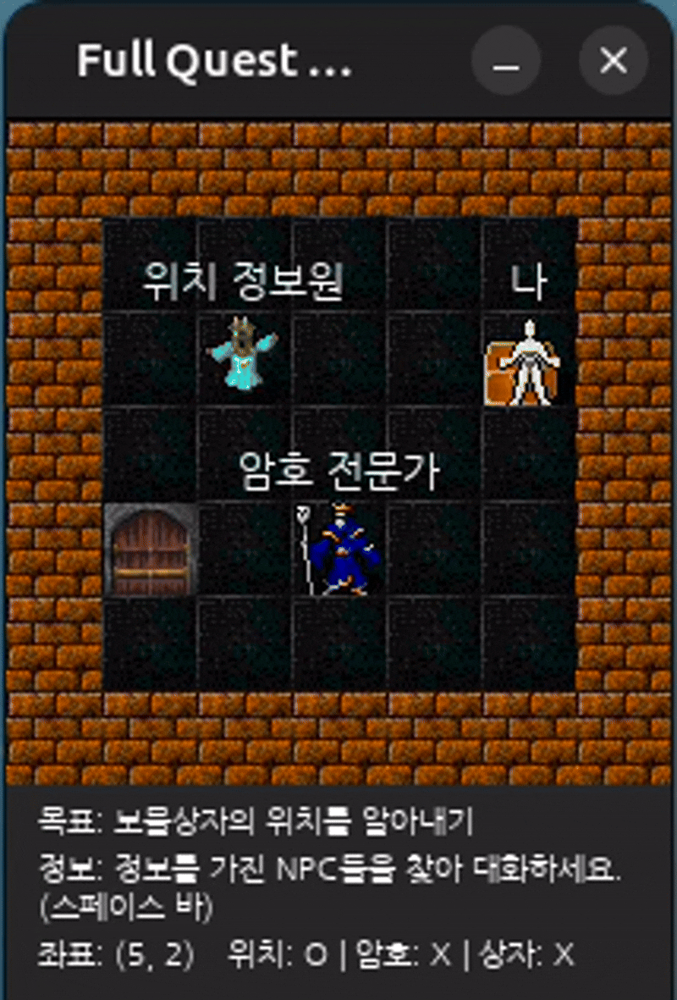
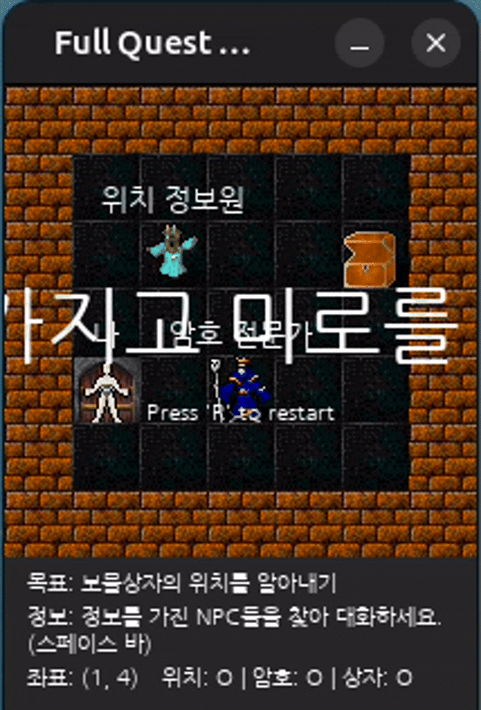

# Procedural Quest Maze (Portfolio Project)

In this Pygame maze, the player asks two NPCs for a treasure's location and password, opens the chest, and reaches the exit. The interactive game uses a local Ollama chat client. A separate Gymnasium environment lets a committed PPO policy (`rl/ppo_full_quest.zip`) attempt the same quest with rule-based NPC interactions, not generated dialogue.

In one reproducible headless run (seeds 0–19, 1024-step limit), the checkpoint completed 14 quests and timed out on 6. This is a small sample, not a general success-rate estimate. [Repeat the run](#evaluate-the-pre-trained-agent).

## Core Features

- **Procedural Maze Generation**: A new, fully connected maze is generated at the start of each game using a randomized algorithm, ensuring unique gameplay every time.

- **LLM-Powered NPCs**: NPCs are driven by an LLM, allowing for dynamic and unscripted conversations. Their personalities and core information are defined in external Markdown files, enabling easy modification and experimentation without changing game code.

  
  

- **Dynamic Quest System**: Players must interact with NPCs to gather crucial information (e.g., the location of a treasure and its password) to complete the objective. The system tracks player knowledge to dynamically update objectives.

- **Modular & Scalable Architecture**: The codebase is intentionally structured to be modular and maintainable, demonstrating a clear **Separation of Concerns (SoC)**:
    - `controllers`: Handle all player input (`InputHandler`) and high-level interaction logic (`InteractionHandler`).
    - `renderers`: Responsible for all on-screen drawing, completely decoupled from the game logic.
    - `games`: Contains the core game state (`Game`) and state definitions (`GameState`).
    - `ui`: Manages UI overlays like menus and text boxes.
    - `configs`: Centralizes all game settings for easy tuning.
    - `clients`: Wraps external services like the LLM, providing a consistent interface to the rest of the application.

## Installation

1.  **Clone the repository:**
    ```bash
    git clone https://github.com/kangnam7654/Game-NPC-with-LLM.git
    cd Game-NPC-with-LLM
    ```

2.  **Install dependencies:**
    It is recommended to use a virtual environment. This project uses dependencies listed in `pyproject.toml`.
    ```bash
    pip install -e .
    ```
    *Note: Heavy libraries like `torch` may require a specific version tailored to your system's hardware (e.g., CUDA support). Please install them according to your environment if needed.*

## How to Run

Execute the main script from the project root directory:

```bash
python main.py
```

## Controls

-   **Movement**: Arrow Keys (↑, ↓, ←, →)
-   **Interact**: Spacebar (when adjacent to an NPC or object)
-   **Menu Navigation**: Arrow Keys (↑, ↓) or Number Keys (1, 2, ...)
-   **Confirm**: Enter
-   **Cancel / Exit Menu**: ESC

## Reinforcement Learning Environment

This project also includes a reinforcement learning environment based on the game logic (`rl/environments/full_quest_env_pass.py`). A PPO agent was trained to attempt the full quest: location NPC → treasure → password NPC → enter the one-digit password at the treasure → exit.




In this environment the NPCs are **rule-based**: being adjacent and choosing "interact" sets the corresponding knowledge flag. No LLM is called, so RL results say nothing about the LLM conversations shown above.

### Evaluate the pre-trained agent

`rl/run_full_quest.py` loads the committed checkpoint (path resolved from the repository root, so it works from any directory), runs the policy deterministically, and prints a JSON report. It never trains, downloads, or calls an LLM.

```bash
# Quick headless evaluation (no window, no delay)
python rl/run_full_quest.py --episodes 20 --seed 0

# Optional: watch it in a Pygame window (needs a desktop)
python rl/run_full_quest.py --episodes 3 --render --delay 0.2
```

- **Seed**: episode *i* is reset with `seed + i`, which reproduces the same map, positions, and password.
- **Horizon**: `--max-steps` (default `1024`, the training limit) is enforced with Gymnasium's `TimeLimit`.
- **Outcome**: each episode is `solved` (the environment *terminated*: treasure opened and exit reached) or `truncated` (time limit hit first). The report also lists the step at which each quest milestone was first reached. It is a small deterministic sample on the listed seeds, not a benchmark.

With the checked-in checkpoint, `--episodes 20 --seed 0 --max-steps 1024` completed 14 quests and truncated 6. For example, seed 2 found the treasure but never obtained the password before the step limit. These are observed outcomes for this checkpoint and these generated layouts only; they do not establish a general completion rate. The report retains per-seed steps and quest milestones, including unsuccessful runs. Only load checkpoints you trust.

### Train the agent (optional)

Training from scratch takes a long time and was not rerun for the result above. `rl/train_full_quest.py` still has a machine-specific path for optional weight reuse; if that path does not exist it starts from scratch rather than resuming. Check that script before running it:
```bash
python rl/train_full_quest.py
```

## Project Structure

```
/
├── actors/             # Game character logic (e.g., NPC class)
│   └── prompts/        # Markdown files defining NPC personalities and knowledge
├── clients/            # Wrappers for external APIs (e.g., LLM client)
├── configs/            # Game settings (screen size, colors, fonts, etc.)
├── controllers/        # Handles player input and interaction logic
├── fonts/              # Font files used in the game
├── sprites/            # Image assets (player, walls, NPCs, etc.)
├── games/              # Core game logic and state management
├── maps/               # Maze generation logic
├── renderers/          # Screen rendering logic
├── ui/                 # UI element management (menus, text boxes)
├── main.py             # Main entry point of the application
├── pyproject.toml      # Project metadata and dependencies
└── README.md           # This file
```